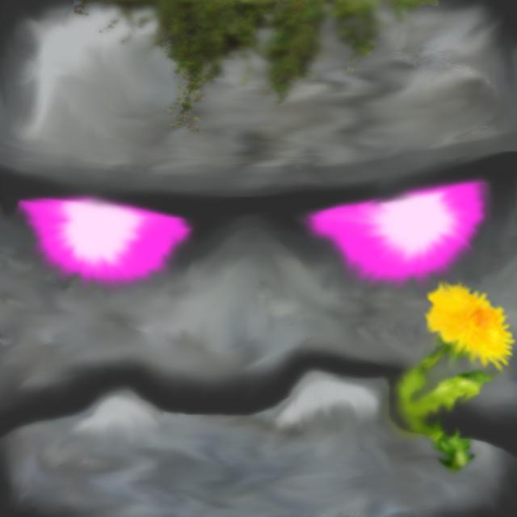

# Golem

General-purpose Discord bot. [Discord.js](https://discord.js.org/) runs the gateway client. [SvelteKit](https://svelte.dev/docs/kit) and [shadcn-svelte](https://www.shadcn-svelte.com/) (preset `b2w2enLDFC`) are the dashboard.

The bot only asks for the `Guilds` intent, which is enough for slash commands.

## Setup

Requires Node.js 24 or newer and pnpm.

1. In the [Discord developer portal](https://discord.com/developers/applications), open the Golem application and add a bot user.
2. Under **Bot**, turn on **Public Bot** so anyone can add Golem, and leave **Requires OAuth2 Code Grant** off.
3. Copy `.env.example` to `.env` and set `DISCORD_BOT_TOKEN`. Set `DISCORD_GUILD_ID` to a test server while developing so command registration is instant.
4. Install dependencies, register commands, and start the bot:

```sh
pnpm install
pnpm db:migrate
pnpm bot:deploy
pnpm bot
```

`pnpm db:migrate` creates `data/golem.db`. The bot also applies pending migrations every time it starts, so in production you only need it if the dashboard starts first.

The bot prints its invite link on startup, and the dashboard has an **Add to Discord** button with the same link.

## Configuration

`config.yaml` is committed and holds public settings: the application ID, the public key, and the permissions the invite link asks for. The comments in that file explain each one.

`.env` holds the bot token and the OAuth client secret and is never committed. It can also set `DISCORD_CLIENT_ID` to run against a separate development application and `DISCORD_GUILD_ID` for a test server.

## Database

Golem uses SQLite through [Drizzle ORM](https://orm.drizzle.team/) and `better-sqlite3`. The bot, the dashboard and the scripts all open the same file, `data/golem.db` by default or `DATABASE_PATH` when it is set. WAL mode lets them read and write at the same time, which is why the dashboard runs on the same host with `adapter-node`.

- `bot/src/db/schema.ts` defines the tables. Store Discord ids as `text`, since they don't fit in a JavaScript number.
- Put queries in modules next to it, like `bot/src/db/guilds.ts`, and import those from commands and the dashboard rather than writing queries inline. That keeps a later move to Postgres in one place.
- After you change the schema, run `pnpm db:generate --name <change>` and commit the new file in `bot/drizzle`.
- Only the bot and `pnpm db:migrate` apply migrations. Drizzle's migrator isn't safe to run from two processes at once.
- Back up the database with Litestream or `sqlite3 data/golem.db ".backup backup.db"`. Copying the file while the bot runs can miss writes still in the `-wal` file.

## Event logging

Servers pick channels for each of 22 events, grouped as server changes, moderation, members and messages. `bot/src/lib/log-events.ts` lists them; its keys are stored in the database, so never rename one.

- `/loghere <event>` logs an event (or `all`) in the current channel, `/logstop <event>` stops it, and `/logs` lists the setup. All three need Manage Server by default.
- The dashboard's server page edits the same `log_channels` table, so changes from either side apply to the next event.
- Handlers live in `bot/src/events/log-*.ts` and post through `sendLog` in `bot/src/lib/logging.ts`, which skips channels where Golem lacks View Channel, Send Messages or Embed Links and forgets channels that no longer exist.
- Deleted and edited messages include their text only if Golem saw the message arrive. Cached messages are swept after six hours.
- Logs don't say who made a change; that would need View Audit Log and an audit log lookup per event.
- **Member joined** has switches (`log_options`) for who invited someone, how many members their inviter has brought in, and how many times they left before. Its row on the dashboard points to the Welcome page, which can show the same things publicly.

Logging uses two privileged intents. Turn on **Server Members Intent** and **Message Content Intent** under **Bot** in the developer portal, or the bot fails to log in with "Used disallowed intents". Past 100 servers, Discord has to verify Golem and approve both.

## Welcome messages

Servers can have Golem post a message when someone joins, set on the dashboard's Welcome page or with `/welcome set [channel] [message]`, `/welcome off` and `/welcome show` (Manage Server by default). Both edit `welcome_settings`; the page and `/welcome show` point back to the **Member joined** log.

- The message is a template. `{user}`, `{username}`, `{server}`, `{membercount}`, `{inviter}`, `{invitecount}` and `{leavecount}` are listed with descriptions in `bot/src/lib/welcome.ts`; unknown `{words}` are left as typed. In `/welcome set`, `\n` is a line break.
- Only the new member is pinged. Apps added to the server aren't welcomed.
- `{inviter}` and `{invitecount}` turn on invite tracking for the server just like the log's "Show who invited them" switch, and need Manage Server too. The log and the welcome message share one invite lookup per join (`joinDetails` in `bot/src/lib/member-join.ts`), since the invite counts can only be compared once.
- Leaves are counted in `member_leaves` for every server, whether or not anything shows them, starting from when this shipped. Kicks and bans count as leaving, since Discord reports them the same way, and leaves while Golem is offline are missed.

## Moderation

`/purge amount:<1–100> [user]` deletes the most recent messages in the channel, or with `user` that member's most recent ones, looking back up to 1,000 messages. It needs Manage Messages by default, and Golem needs View Channel, Read Message History and Manage Messages in the channel; the invite link doesn't ask for them, so the reply names any that are missing. Pinned messages are kept, and Discord doesn't let bots bulk-delete messages older than 14 days. Purges show up in event logs as "Messages purged".

## Leveling

Members earn 15–25 XP per message or use of a Golem slash command, at most once a minute, separately for each server and for a global total. Bots, webhooks, system messages and anything in DMs earn nothing.

- Leveling commands are **off by default in every server**. The dashboard's Leveling page has a master switch (`guild_settings.level_commands`) and a switch per command (`guild_level_commands`, listed in `levelCommands` in `bot/src/lib/levels.ts`). A command that's off replies privately that it's off there. Members earn XP in the server either way, and the commands always work in DMs.
- Servers can't turn off XP for commands right now. The switch, its `guild_settings.command_xp` column and the dashboard action still exist behind `COMMAND_XP_SETTING` in `bot/src/lib/levels.ts`; set it to `true` to bring the switch back. Commands always count toward global XP.

- `/level` replies with a card showing your level and progress toward the next one; `/rank` replies with a card showing your place large and your level smaller. In a DM with Golem they show the global numbers, the same as `/globallevel` and `/globalrank`.
- `/leaderboard` shows the server's top members ten to a page, and `/globalleaderboard` the top across every server (also what `/leaderboard` shows in a DM). The server board uses nicknames and lists people who have left under their Discord name; the global board always uses Discord names. Previous/Next buttons page through it, and only the person who ran the command can press them. Their custom id carries the scope, owner and page, so they keep working across restarts, and they obey the same switches as the commands. Your row is highlighted; if you're not on the page, the footer says where you are. Drawn by `bot/src/lib/leaderboard-card.ts`.
- Levels follow the curve most leveling bots use: level L needs `5L² + 50L + 100` more XP (`bot/src/lib/levels.ts`). Ties share a rank.
- The card is drawn by `bot/src/lib/level-card.ts` with satori (layout and text) and resvg (PNG), using the Outfit font from `@fontsource/outfit`, so it needs no system fonts. Scripts other than Latin and emoji in names render blank.
- Server XP is kept when someone leaves and deleted when Golem leaves the server.

## Games

Games are **off by default in every server**. The dashboard's Games section has a master switch and a switch per game (`guild_settings.games_enabled` and `guild_games`, checked by `gameBlocked` in `bot/src/db/guild-games.ts`); while a game is off, starting it or pressing Play again / Cast again replies privately that it's off, and a game already in progress finishes. DMs with Golem are always allowed. New games go in `bot/src/lib/games.ts` and get a switch automatically. Discord still lists the commands in servers where they're off.

Games are played for **chips**, one balance per person shared across servers and DMs. Everyone starts with 1,000; `/daily` gives 200 more every 24 hours and `/chips` shows the balance. The name and amounts live in `bot/src/lib/chips.ts`.

`/blackjack bet:<chips>` deals a hand (leave `bet` out to play for fun, with no chips involved) and replies with an image of the table plus Hit, Stand and Double down buttons. Only the player who started a game can press them, and a finished hand offers **Play again** at the same bet. Play again and fishing's Cast again start the next game in a new message, leaving the finished one with its result; `bot/src/lib/messages.ts` posts it and makes sure each finished message starts only one game.

- Wins pay 1:1, a natural blackjack pays 3:2 (rounded down) and a push returns the bet. The dealer stands on every 17, a natural on the deal ends the hand at once, and doubling down is allowed on the first two cards. Splitting isn't supported yet. Each game uses a fresh deck shuffled with `crypto.randomInt`.
- Cards arrive one at a time, 0.7 seconds apart (`animation.delayMs`), through a few message edits: the opening deal, then the hole card turning over and each dealer draw after you stand. The hand is decided and paid before the cards finish arriving; the frames only show it.
- A bet is taken when the hand is dealt and kept in `chip_holds` until it settles. Games live in memory, so a restart refunds every open hold at startup; a hand idle for 5 minutes stands automatically and settles.
  `/fish` casts a line: Golem shows an animated GIF of fish swimming under a bobber, and after 3–8 seconds swaps it for the bite, with the line pulled tight to the left, down or to the right. The player has 4.5 seconds to press the matching button. The fish is one of nine species from common to legendary (50/30/14/5/1 in 100) with a random weight, and rarer fish fight longer: common fish take 1–3 correct pulls, legendary ones 7–9. Each pull sends the line a new direction with a fresh clock and progress dots in the corner; a wrong or late pull loses the fish and reveals what it was. Catches aren't saved or worth chips yet.

- The scenes are plain SVG rendered by resvg (`bot/src/games/fishing.ts`); the GIF is encoded with gifenc from one shared palette and loops seamlessly. A GIF takes about 1.5 seconds to draw, so the first four casts each draw one and later casts reuse them.
- Timing lives in `timing` in `bot/src/commands/fish.ts`. Each pull's clock starts once it is on screen, and pull buttons carry the pull number so a doubled or late press can't count twice.

More games, all with an optional `bet` (leave it out to play for fun) and a replay button that starts a new message:

- `/higherlower`: guess whether the next card is higher or lower. Aces are high and ties redraw. Each correct guess multiplies the payout by 0.97 ÷ the chance it had (never below ×1), capped at ×100; cash out any time after a correct guess. Impossible guesses are disabled.
- `/videopoker`: Jacks or Better on the 9/6 paytable (`bot/src/games/video-poker.ts`). Hold buttons only update the buttons, so toggling is instant; Draw settles the bet.
- `/connect4` and `/tictactoe`: challenge a member (they Accept or Decline within 2 minutes; the challenger can withdraw), or leave `opponent` out to play Golem, which also works in DMs. With a bet, each player stakes it and the winner takes both; a draw refunds. A player who doesn't move for 5 minutes forfeits. `bot/src/lib/match.ts` runs challenges, turns, stakes and rematches for any two-player game; each game only supplies its rules, Golem's AI and its board.
- `/trivia`: a question for the whole channel from a bundled bank of 60 (`bot/src/games/trivia-questions.ts`), with an optional category. Everyone answers once, privately; after 20 seconds Golem reveals the answer and pays 25 chips to the fastest correct answer and 10 to the others. A channel doesn't get the same question again within 20.

- `bot/src/games/cards.ts` holds the deck and the playing card drawing for future card games. All images share `bot/src/lib/image.ts` with the level and rank cards; games use the Playfair Display serif and everything else Outfit.
- Commands can handle their own buttons: a button whose custom id starts with `<command name>:` goes to that command's `button` function.

## Feeds

Servers and DMs can follow RSS/Atom feeds, YouTube channels, and Twitch and Kick streamers. Servers manage them on the dashboard's Feeds page or with `/feed add`, `/feed list` and `/feed remove` (Manage Server by default); in a DM with Golem, `/feed` follows feeds for that person's DMs, and the dashboard's Your feeds page (under Your servers, after Golem's logo in the rail) manages the same list. Golem can only DM someone who shares a server with it and allows DMs from its members.

- Each source (`feed_sources`) is checked once however many servers and DMs follow it (`feed_subscriptions`), and deleted once nothing does. Feeds and YouTube are checked every 10 minutes, streamers every 2 (`feedKinds` in `bot/src/feeds/sources.ts`). The poller in `bot/src/feeds/poller.ts` starts when the bot is ready.
- New subscriptions post only what appears after they're added. At most 5 posts per check, oldest first. A source that keeps failing is checked less often, up to every 6 hours, and its error shows on the dashboard and in `/feed list` until it works again; so does a channel Golem can't post in.
- RSS/Atom accepts a feed link or a website that links to its feed. YouTube accepts a handle, a channel link or a channel id and uses YouTube's public feed (no key). YouTube's feeds return 404 now and then, so a 404 counts as nothing new rather than an error.
- Twitch and Kick need free applications from their developer consoles: `TWITCH_CLIENT_ID`/`TWITCH_CLIENT_SECRET` and `KICK_CLIENT_ID`/`KICK_CLIENT_SECRET` in `.env`. Without them those types show as not set up. Both the bot and the dashboard read them.
- Feed links come from users, so `bot/src/feeds/fetch.ts` refuses private, loopback, link-local and other internal addresses on every redirect and at connect time, caps responses at 5 MB and 15 seconds, and only follows http and https.
- Limits: 25 feeds per server, 10 per person in DMs. X isn't supported: reading posts needs X's paid API.

## Dashboard

People sign in with Discord at `/dashboard/` and see the servers they own or have Manage Server in; the others get an invite link with that server preselected. The dashboard is laid out like Discord's app: a rail of server icons on the left (`src/lib/components/dashboard/server-rail.svelte`), then a column listing that server's settings pages like channels, with the signed-in user at the bottom (`channel-sidebar.svelte`, built from shadcn-svelte's Sidebar). Each settings category is its own page, such as `/dashboard/<server>/logging/` and `/dashboard/<server>/games/`, and `/dashboard/<server>/` opens the first one. On phones both columns slide out from a menu button.

Setup, in the developer portal under **OAuth2**:

1. Copy the **Client Secret** into `.env` as `DISCORD_CLIENT_SECRET`.
2. Add a redirect for every origin the dashboard runs on. The trailing slash is required, because every route ends in one (`trailingSlash = 'always'`) and Discord matches redirects exactly:
   - `http://localhost:5173/auth/callback/` for `pnpm dev`
   - `https://your-domain/auth/callback/` in production

How it works:

- Sign-in asks only for `identify` and `guilds`. The session cookie is `httpOnly`, and the database stores a SHA-256 hash of it, never the cookie itself.
- Sessions last as long as Discord's token (7 days). If someone revokes Golem in Discord's settings, their next dashboard visit ends the session and starts a fresh sign-in.
- Each dashboard load checks access itself with `managedGuilds`/`managedGuild` in `src/lib/server/guilds.ts`. A server the person cannot manage is a 404.
- Each person's server list is cached for a minute, because Discord rate limits that endpoint.
- `+server.ts` endpoints do not inherit `trailingSlash` from the layout, so each one exports it.

### Running it in production

```sh
pnpm build
node --env-file=.env build
```

adapter-node builds the site's origin from the `Host` header and assumes `https`. That origin is used for the OAuth redirect, link previews and SvelteKit's CSRF check, so the reverse proxy in front of it must pass `Host` through. If it sends the original host in another header instead, set `HOST_HEADER=x-forwarded-host` (and `PROTOCOL_HEADER=x-forwarded-proto` if it isn't HTTPS-only). Running `node build` over plain HTTP makes sign-out fail with "Cross-site POST form submissions are forbidden", since the browser's `http://` origin won't match.

## Deployment

Golem runs on `hetzner-arch` in `~/golem` with Docker Compose, at https://golem.rudeus.net behind Cloudflare and the Caddy container in `~/master`.

```sh
scripts/deploy.sh
```

The script uploads every file git would track (so not `node_modules`, `data/` or `.env`), replaces the previous copy, and runs `docker compose up -d --build`. `compose.yaml` starts three containers from one image:

- `migrate` applies pending migrations once, then exits. The other two wait for it.
- `golem_bot` is the gateway client.
- `golem_web` is the dashboard on port 3000. It joins Caddy's `master_default` network, and the Caddyfile has `reverse_proxy http://golem_web:3000` for the domain.

On the server, `~/golem/.env` (created once by hand, mode 600) and `~/golem/data/` survive every deploy. After changing commands, register them from the server:

```sh
ssh hetzner-arch 'cd ~/golem && docker compose run --rm --no-deps bot node bot/src/deploy-commands.ts'
```

Don't run `pnpm bot` locally with the production token while the server is up: both processes would receive every interaction, and one of them fails to reply.

## Running as a public bot

- Commands are server installs (`setIntegrationTypes(GuildInstall)`) and work in servers and in DMs with Golem (`setContexts`). Set both on every new command.
- `pnpm bot:deploy:global` publishes commands to every server and clears the test server's copies so they don't show up twice. Global changes can take up to an hour to appear.
- The client uses `shards: 'auto'`, so it stays under Discord's 2,500 servers per shard limit without code changes. Past a few thousand servers, move to discord.js's `ShardingManager` so shards run in separate processes.
- Replies never ping anyone by default (`allowedMentions: { parse: [] }`). A command that should ping must opt in on that reply.
- Replies from `/help` and `/ping` are ephemeral, so they don't clutter other people's channels.

The dashboard:

```sh
pnpm dev
```

## Scripts

| Script                   | What it does                            |
| ------------------------ | --------------------------------------- |
| `pnpm dev`               | SvelteKit dashboard                     |
| `pnpm bot`               | Log in and listen for slash commands    |
| `pnpm bot:deploy`        | Publish slash commands to Discord       |
| `pnpm bot:deploy:global` | Publish globally, clear the test server |
| `pnpm db:generate`       | Create a migration from schema changes  |
| `pnpm db:migrate`        | Apply pending migrations                |
| `pnpm check`             | Typecheck the dashboard and the bot     |
| `pnpm lint`              | Prettier and ESLint                     |

## Adding a command

Add a module in `bot/src/commands` that exports `command` with `data` (a `SlashCommandBuilder`) and `execute`. `bot/src/commands/ping.ts` is the pattern. Register it again with `pnpm bot:deploy`. `/help` and the dashboard list it automatically. Command modules must not import `bot/src/config.ts`, because the dashboard loads them too and has no token.

Events live in `bot/src/events` and export `event` with `name` and `execute`, or an `events` array to group related handlers like the `log-*.ts` files do. Helpers commands share go in `bot/src/lib`, since every file in `bot/src/commands` is loaded as a command.
